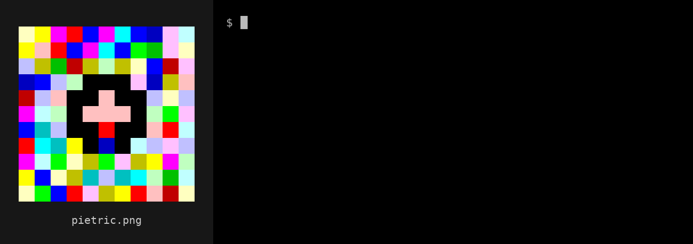
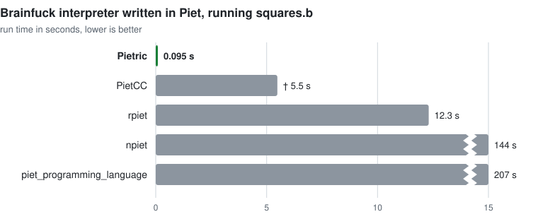

# Pietric

[English](README.md) | 日本語

**最速の Piet コンパイラ**：生成したプログラムは [PietCC](https://github.com/pwang00/pietcc) の 5〜130 倍、インタプリタ [npiet](https://www.bertnase.de/npiet/) の 150〜4,900 倍の速さで動きます（[ベンチマーク](bench/README.ja.md)）。



Pietric は、Piet のための C++ 製コンパイラです。Piet は、プログラムを抽象画として描く、スタックベースの難解プログラミング言語です。Pietric は LLVM IR を中間表現とし、そこから機械語を生成します。Piet のスタックと入出力は生成する IR の中に直接実装しているので、LLVM の最適化がすべての操作を見通せます。生成したプログラムが必要とするのは C ライブラリ（POSIX の `write` と `isatty` を含む）だけです。

## 性能

<picture>
  <source media="(prefers-color-scheme: dark)" srcset="docs/benchmark-dark.svg">
  
</picture>

各行は1つの Piet プログラムで、どの処理系にも同じ入力を与えています。単位は秒で、小さいほど速いです。すべてのベンチマークの結果は [bench/README.ja.md](bench/README.ja.md) にあります。

| プログラム | **Pietric** | PietCC | npiet | rpiet | piet_programming_language |
|---|---|---|---|---|---|
| Piet 製 Brainfuck インタプリタで `squares.b` を実行 | **0.095** | 5.5 † | 144 | 12.3 | 207 |
| アッカーマン関数 A(3, 12) | **0.343** | 43.5 | > 600 | > 600 | > 600 |
| 竹内関数 tak(26, 16, 8) | **0.589** | 6.21 | 292 | 127 | > 600 |
| 試し割りで 500,000 までの素数を数える | **0.173** | 5.73 | 270 | 68.4 | > 600 |
| 10⁷ 個の数値を出力 | **0.155** | 0.79 | 24.0 | 7.47 | 240 |

Pietric と PietCC はコンパイラで、表の時間はコンパイルしたプログラムの実行時間です。[npiet](https://www.bertnase.de/npiet/)、[rpiet](https://github.com/tessi/rpiet)、[piet_programming_language](https://github.com/your-diary/piet_programming_language) はインタプリタです。† は最適化なしの PietCC です（`--o2` ではコンパイルが30分で終わりませんでした）。実行は 600 秒で打ち切っています。計測は Intel Core i5-12400 で行いました。詳細と、手元で再現する方法は [bench/README.ja.md](bench/README.ja.md) を見てください。

## ビルド

### Docker で使う

Docker イメージには LLVM 20 が入っています。イメージをビルドして、カレントディレクトリのプログラムをコンパイル・実行します。
```bash
docker build -t pietric .
docker run --rm -i -v "$PWD:/work" pietric run program.png
```
コンパイルだけする場合（実行ファイルは Linux で動きます）：
```bash
docker run --rm -v "$PWD:/work" -u "$(id -u):$(id -g)" pietric program.png -o program
```

### ソースからビルドする

> [!NOTE]
> 環境変数 `LLVM_DIR` に、LLVM の CMake 設定ファイルがあるディレクトリを設定してください。CMake が LLVM を見つけるのに使います。

ビルドには CMake を使います。

1. **ビルド用ディレクトリを作る**  
   プロジェクトのルートで、ビルド用のディレクトリを作って移動します。
   ```bash
   mkdir build
   cd build
   ```

2. **CMake を実行する**
   ```bash
   cmake ..
   ```
   （または `cmake .. -DLLVM_DIR=/path/to/lib/cmake/llvm`）

3. **ビルドする**
   ```bash
   make
   ```

ビルド用ディレクトリにコンパイラ `Pietric` ができます（`CMAKE_BUILD_TYPE` を指定しなければ Release ビルドです）。

## 使い方

Pietric は、画像（PNG、GIF、BMP）か、空白区切りの16進カラーコードを書いたテキストファイルの Piet プログラムを受け取り、実行ファイルにコンパイルします。
```bash
./Pietric path/to/program.png -o program
./program
```
内部では LLVM の `opt` と `llc`（Pietric のビルドに使った LLVM のもの、なければ `PATH` 上のもの）で最適化とホスト向けの機械語生成を行い、C コンパイラ `cc` でリンクします。生成したプログラムに必要なのは C ライブラリだけです。

オプション：

| オプション | 効果 |
|---|---|
| `-o <file>` | 出力ファイル。既定は `a.out`（`--emit-llvm` / `-c` のときは `<program>.ll` / `<program>.o`） |
| `-O0` … `-O3` | 最適化レベル（既定は `-O2`）。`-O0` は最もコンパイルが速く、非常に大きなプログラムで役立ちます |
| `--emit-llvm` | 実行ファイルの代わりに、指定レベルで最適化した LLVM IR を出力 |
| `-c` | 実行ファイルの代わりにオブジェクトファイルを出力 |
| `--cc=<program>` | リンクに使う C コンパイラ（既定は `cc`） |
| `-march=<cpu>` | 指定した CPU 向けのコードを生成。例えば `-march=native` でこのマシンの CPU 向け、`-march=x86-64-v3` など。ループがベクトル化される場合に速くなりますが、古い CPU では動かないことがあります。既定はホストのアーキテクチャのどの CPU でも動くコード |
| `-v` | 画像から検出したコーデルサイズを表示 |

`--emit-llvm` で出した IR は、LLVM のツールでビルドすることもできます。
```bash
./Pietric -O0 --emit-llvm program.png -o program.ll
opt -O3 program.ll -S -o optimized.ll
llc optimized.ll -relocation-model=pic -filetype=obj -o program.o
cc program.o -o program
```

## 最適化

Pietric は、できることはコンパイル時に済ませ、残りは LLVM が Piet のスタックをレジスタに置けるようにコードを組み立てます。

- **画像の静的解析**：画像をプログラムの状態（色ブロックと DP・CC の組）のグラフにし、出口、白マスの通過、ふさがれた辺をすべてコンパイル時に解決します。さらにグラフ上の解析で、スタックの上に必ずある値を見つけます。これで、push した定数による roll は値の付け替えになり、ゼロ除算のようなチェックも消えます。
- **スタックをレジスタに**：各状態を、そこに到達しうるスタックの深さ（16まで）ごとに1回ずつコンパイルします。すると深さは定数になり、スタックの値はすべて SSA 値になります。`tests/cases/pietric.png` は、`pietric` を書き込む7回だけに畳み込まれます。もっと深いスタックでも、上の8個はレジスタに残し、残りだけをヒープ上のバッファに置きます。
- **非常に大きなプログラム**：コピーの数が上限を超えた先では、スタックをヒープに置くコードになります。そのコードは数百状態ずつの関数に分けるので、LLVM が巨大な関数を扱うことはありません。

## 意味論

Pietric は [Piet の仕様](https://www.dangermouse.net/esoteric/piet.html)に従います。仕様が選択を委ねている点では、次のように動作します。

- 値は 32 ビット符号付き整数で、算術演算はオーバーフローすると循環します。
- スタックは必要に応じて伸びます。メモリが尽きた場合は stderr に報告し、終了ステータス 1 で終了します。
- スタックにある値より多くの値を必要とする命令は、仕様が実行できない操作について定めるとおり無視します。
- `divide` は 0 方向に切り捨てます。`mod` の結果は除数（一番上の値）と同じ符号になります。0 による除算・剰余は、仕様の推奨どおり無視し、両方のオペランドをスタックに残します。
- 深さが負、または残りの値の数より大きい `roll` は無視し、2つの引数をスタックに残します。
- `pointer` は、取り出した値を 4 で割った余りの回数だけ DP を時計回りに回します（負の値なら反時計回り）。`switch` は、取り出した値の絶対値の回数だけ CC を切り替えます。
- `in(number)` は空白を読み飛ばし、符号付きでもよい10進整数を読みます。`in(char)` は1バイト読みます。何も読めない場合（入力の終わり、または現在位置に数がない場合）は何も積みません。`out(char)` は値の下位1バイトを書きます。
- 出力はプログラム内でバッファし、64 KiB たまったとき、入力を読む前、終了時に書き出します。stdout が端末なら改行ごとにも書き出します。強制終了されたプログラムは、まだ書き出していない出力を失います。
- 白いコーデルの通過は、仕様の 2008 年の補足に従います。白の領域内で同じ経路をたどり直そうとした時点でプログラムは終了します。
- プログラムは左上のコーデルから始まります。それが黒か白なら、コンパイルしたプログラムは何もしません。
- Piet の 20 色以外の色は、すべて1つの追加の色として扱います。そのコーデルも他の色と同じくブロックを作りますが、そこへの出入りで命令が実行されることはありません。

## テスト

`tests/cases/` のプログラムをコンパイル・実行して出力を確かめる E2E テストがあります。ビルド用ディレクトリで `ctest --output-on-failure` を実行してください。詳しくは [tests/README.ja.md](tests/README.ja.md) を見てください。

## ファイル構成

```
Pietric/
├── CMakeLists.txt         # CMake のビルド設定
├── Dockerfile             # Pietric と LLVM 20 入りの Docker イメージ
├── README.md              # このドキュメント（英語）
├── README.ja.md           # このドキュメント（日本語）
├── .gitignore             # git が無視するファイル・ディレクトリ
├── include/
│   ├── PietTypes.h        # Piet の色、DP/CC、命令の定義
│   ├── Utils.h
│   ├── Parser.h
│   ├── Graph.h
│   ├── IRBuilder.h
│   ├── Runtime.h
│   └── Backend.h
├── src/
│   ├── main.cpp        # コマンドラインのドライバ：オプションを解析し、以下の段階を実行
│   ├── Utils.cpp       # ユーティリティ関数（16進文字列の変換など）
│   ├── Parser.cpp      # 入力ファイル（16進コードのテキスト、BMP/PNG/GIF 画像）の解析
│   ├── ImageLoader.cpp # stb_image ライブラリによる画像の読み込み
│   ├── Graph.cpp       # Piet の DP・CC の規則に従って実行グラフを構築
│   ├── IRBuilder.cpp   # 実行グラフから LLVM IR を生成（スタック操作はインライン）
│   ├── Runtime.cpp     # 生成するモジュールに埋め込む補助関数（スタックの拡張、roll、入出力）
│   └── Backend.cpp     # モジュールの最適化、機械語の生成、実行ファイルのリンク
├── tests/
│   ├── run_tests.sh    # cases/ のすべてのプログラムをコンパイル・実行・検証
│   ├── gen_cases.py    # cases/ のテキスト形式のテストプログラムを生成
│   ├── cases/          # テストプログラムと期待する出力（と入力）
│   └── README.md       # テストの実行方法と追加方法（日本語は README.ja.md）
├── bench/
│   ├── run.py          # Pietric と他の Piet 処理系でベンチマークを実行
│   ├── programs.py     # ベンチマーク用のプログラムを生成
│   └── README.md       # ベンチマークの詳細と実行方法（日本語は README.ja.md）
└── docs/
    ├── demo.gif        # 冒頭のデモ（demo.tape から make_demo.sh で作成）
    └── benchmark-*.svg # 性能の節のグラフ（ライト・ダーク用、make_chart.py で作成）
```

## ライセンス

MIT ライセンスです。詳しくは [LICENSE](LICENSE) を見てください。

## 謝辞

- **Piet 言語**：David Morgan-Mar 氏が考案しました。
- **LLVM**：堅牢なコンパイラ基盤を提供してくれています。
- **stb_image**：画像を手軽に読み込めます。
